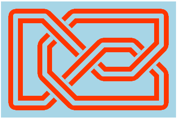

# celticbook
A LaTeX learning project. The plan (not currently executed) is to create a book similar to dmackinnon1/Truchet-Book that covers some small
set of celtic patterns created using the grid method.

## Original notes (dmackinnon1/celtic)
Generator and editors for Celtic Knot patterns.
Please see the live example here: https://dmackinnon1.github.io/celtic.

The classes for doing various things with the knots are spread over a few js files:
- **celtic_base.js** Basic knot classes.
- **celtic_display.js** Classes for rendering static SVG knot representations.
- **celtic_editor.js** Classes and functions for SVG knot editor.
- **celtic_calc.js** Functions that perform some calculations on the knot (crossing counts, region counts).

Some code for generating static knots below, see index.html for example of editable knot display.

### example 1 - The Trefoil
```{javascript}
//setup the grid, height 3, width 3 (results in x ranging from 0 to 4, y from 0 to 4)
let grid = new Grid(3,3);
grid.initialize();
grid.borders();
//connect nodes on secondary grid
grid.from(1,3).to(3,3);
//use a display object to create an svg
let display =  new RibbonKnotDisplay(grid, 40, 'white', 'darkblue');
let knotDiv = document.getElementById('knot');
knotDiv.innerHTML = display.init().build();
```


### example 2 - The Figure Eight

```{javascript}
//setup the grid, height 3, width 4 (results in x from 0 to 6, y from 0 to 4)
let grid = new Grid(3,4);
grid.initialize();
grid.borders();
//connect nodes on secondary grid
grid.from(1,1).to(1,3);
grid.from(3,1).to(5,1);
grid.from(3,3).to(5,3);	
//use a display object to create an svg
let display =  new RibbonKnotDisplay(grid, 40, 'lightblue', 'orangered');
let knotDiv = document.getElementById('knot');
knotDiv.innerHTML = display.init().build();
```


## The process
Consider the three celtic design patterns shown in the image below.


The three examples above are the same celtic knot pattern shown in three slightly different styles. All the examples above are based on the same grid:


The grid has primary points (shown in grey) and secondary points (shown in black). Breaks in the pattern are created by connecting secondary points following a few rules. The ribbon pattern is then drawn on the grid. The three styles shown are the result of three different approaches to drawing the ribbon once the grid is established.

- The top image is created by filling in the spaces between the "ribbon" of the pattern.
- The middle image is created by following rules that create sections of ribbon around the <i>secondary</i> grid points.
- The bottom image is created by following some rules to create sections of the ribbon around the <i>primary</i> grid points.

All three use the idea of primary and secondary grid points, and creating the structure that defines the&nbsp; patterns by joining up the secondary grid points. So the first steps of all three approaches involves setting up this basic structure.

1) **define primary grid points**
A knot pattern is laid out on a square coordinate system using a set of "primary" points that are set at one unit distances in the horizontal and vertical directions. We'll say that (0,0) is the top left corner of the grid, and the positive&nbsp;<i>x</i>&nbsp;direction is towards the right and positive&nbsp;<i>y</i>&nbsp;direction is down.&nbsp; The dimensions of the primary grid must be odd (there must be a total odd number of dots in both the&nbsp;<i>x</i>&nbsp;and&nbsp;<i>y</i>&nbsp;directions). Because we are starting with (0,0) in the top left, the top right point (<i>x</i>, 0) must have x even (4 in the example below), and the bottom left point (0,<i>y</i>) must have y even (6 in the example below).


2) **identify secondary grid points**
Some of the points on the grid are special - these form a secondary grid. The special secondary grid points are those where both&nbsp;<i>x</i>&nbsp;and&nbsp;<i>y</i>&nbsp;values are even, or both are odd.


3) **place boundaries**
To create an edge-boundary for the pattern, and to create more interesting twists and turns, we follow some rules for drawing boundaries on the grid.

- **boundary rule 1**: A boundary can connect any two non-diagonally adjacent secondary points, as long as rule 2 is not violated. The midpoint of a boundary segment will be a primary point.
- **boundary rule 2**: A primary point cannot have more than one boundary going through it.

The example below shows boundaries drawn along the edge of the image, as well as some internal boundaries.


### Three ways to draw the pattern
Now that the grid is drawn with primary and secondary points, there are different approaches to actually creating the celtic knot pattern from the grid.

#### method 1: Negative space around the secondary points

To create an intertwined ribbon we can fill in the spaces around the ribbon - in addition to the boundaries already drawn, the secondary grid points are built up into polygons, and the "weaving effect" is created by drawing filaments that extend out of the secondary grid polygons, in one direction for even secondary points, the opposite for odd secondary points.


If an adjacent primary point has a boundary through it, the line extending from the secondary point in the direction of that primary point is simply not drawn, and the corner of the polygon without a line extending from it is truncated.


#### method 2: Ribbon sections around the secondary points

Restarting with just the underlying grid and boundaries, instead of filling in the spaces between the ribbon, we can draw the ribbon itself by drawing sections of the ribbon around the secondary points. Again, there is an even/odd rule in order to allow for the ribbons to pass over each other. For the node in the center, the following patterns are followed:


When these are joined together, the ribbon fragments form a set of continuous paths, and weave over and under each other.


If one of the primary points surrounding the secondary point has a boundary through it, the fragments are bent and joined:


Connecting all the lines and erasing the points and boundaries, we get something like the image below.


#### method 3: Ribbon sections around primary points

For this method, we look only at primary points that are not part of the secondary grid. This includes primary points that have (<i>x</i>,<i>y</i>) values where <i>x</i> is even and <i>y</i> is odd, or where <i>x</i> is odd and <i>y</i> is even (remember, secondary points have both x and y values even or both <i>x</i> and <i>y</i> values odd).

Like method 2, ribbon fragments are drawn, but this time the focus is on the primary nodes. again, what is drawn is different based on an "even vs odd" rule:


Dealing with boundaries is easier with this method, there are only two cases to consider - a vertical boundary or a horizontal boundary.


Any ribbon fragment that would lie outside the boundary of the grid is not drawn. Connecting all the lines and erasing the points and boundaries, we get something like the image below.


These three methods are pretty equivalent - small style alterations in any one of them can make the resulting knot look identical to one drawn using another method. When drawing knots by hand, I find that something along the lines of method 1 is easiest to use; however, from implementing each of the above in simple programs, I found that method 3 was the simplest to code.

